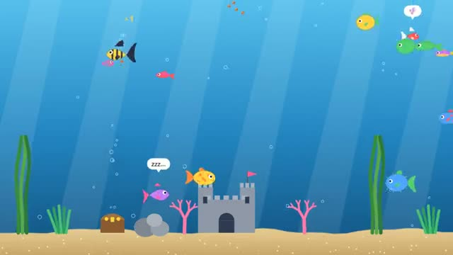

# Fish Tank

Design a fish. Share one tank with everyone. A multiplayer starter game from [Multiplayer Agent](https://multiplayeragent.com): 2D, drop-in, 1–30 players, with bot fish that keep the tank lively.

## How it plays

Pick your fish's shape, fins, pattern and colors, then swim with everyone else's. Drop food and race to it to grow, tap the glass to make everyone dart, decorate the tank with plants and castles, and chat in bubbles. The tank remembers your fish and your decorations.

**Controls:** Click or tap where to swim (or WASD), F to feed, T to tap the glass, Enter to chat. On a phone: tap to swim and use the buttons.

## Make it yours in the Game Builder

Open the [Game Builder](https://multiplayeragent.com), choose **Start from a starter game** and pick Fish Tank. It opens as version 1 in your studio, ready to play and publish. Then ask for changes, for example:

- Add a shark that chases the fish every few minutes
- Let fish wear little hats
- Add a day and night light with glowing fish at night

## Run it yourself

1. Get a free publishable key (`pk_…`) at [multiplayeragent.com](https://multiplayeragent.com).
2. In `index.html`, put it in place of `pk_REPLACE_ME` in the `MP_CONNECT` block.
3. Open `index.html` in a browser. No build step and no server needed.

Without a key it still runs, offline with bot fish.

## How it is built

- One `index.html`. The comment at the top of the script maps the code and explains the multiplayer.
- **World memory:** Players' browsers keep a copy of the tank (decorations and the fish of people who visited), so it comes back after the room empties.
- **Saves:** Your fish, its size and how hungry it is are kept for you between visits.
- **Leaderboard:** Your fish's growth points, all time.
- **Bots:** Bot fish, and the remembered fish of people who are away, keep the tank lively.
- **Host-run rules:** The host's browser drops the food, decides who ate each pellet and places decorations; if it leaves, the next player takes over.
- **Live sync:** Everyone sees every fish swim, every pellet sink and every chat bubble.
- `?attract` runs it offline with bot fish only. The preview video is recorded from it.

## License

MIT.
